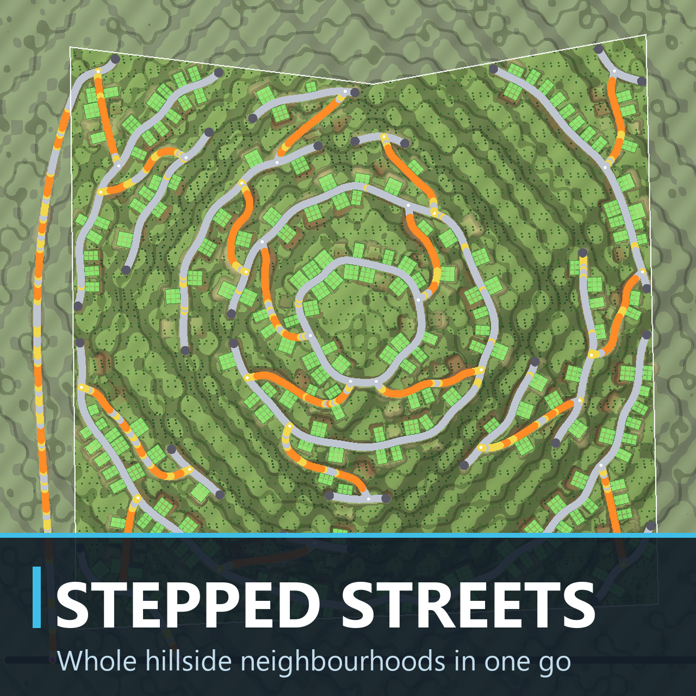
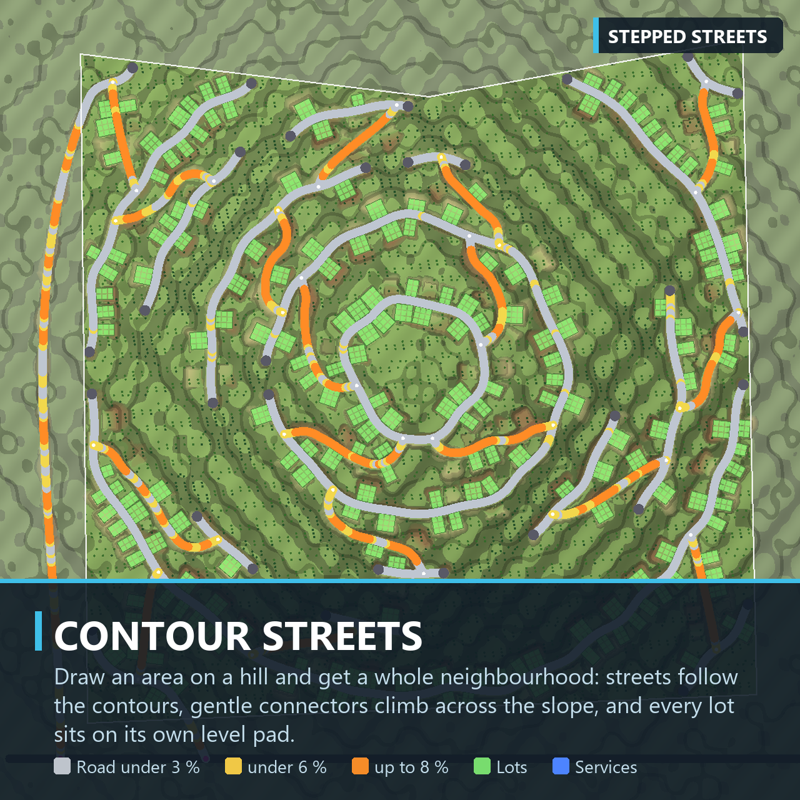
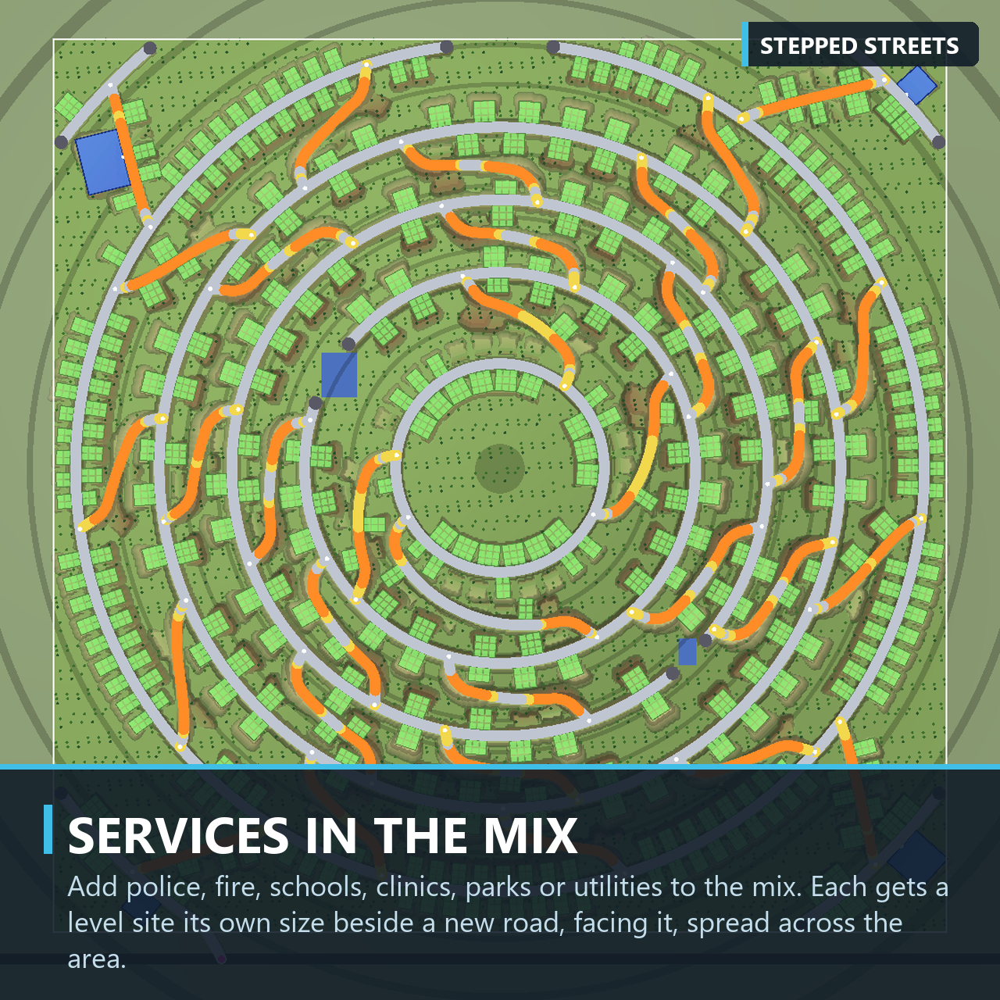
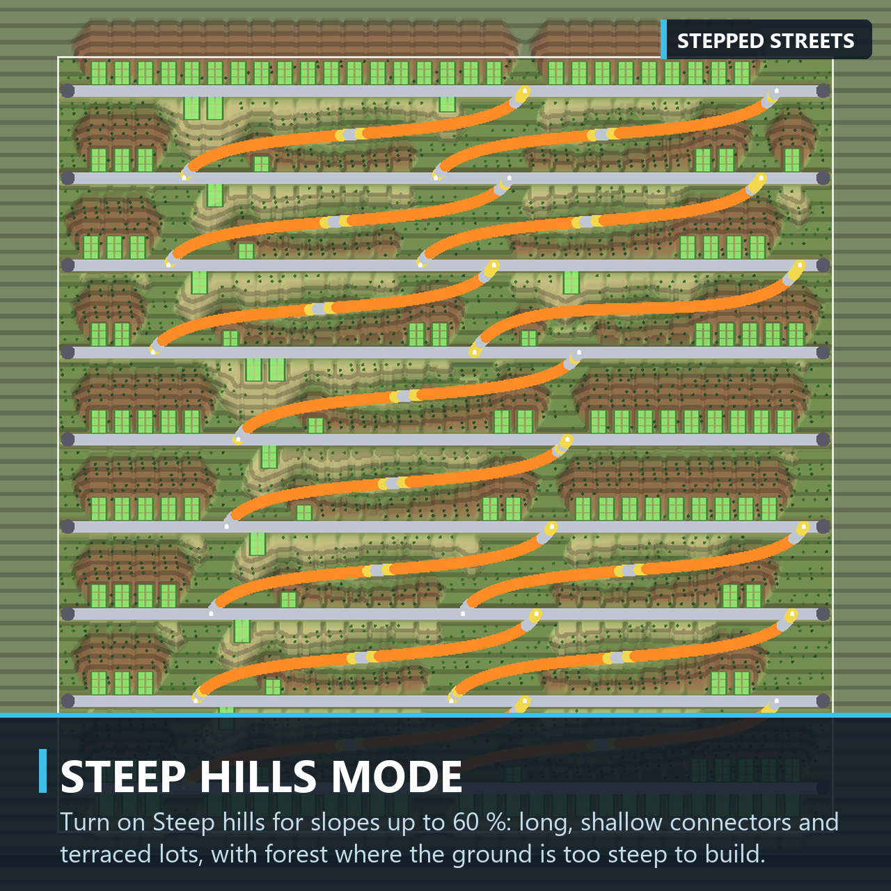
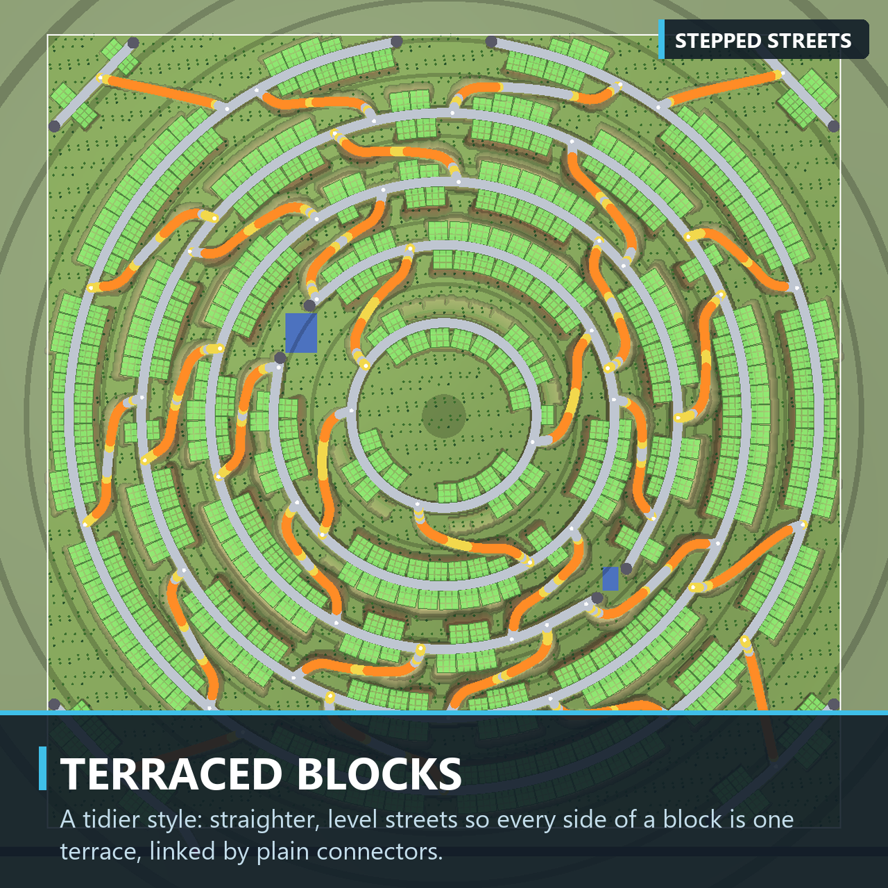
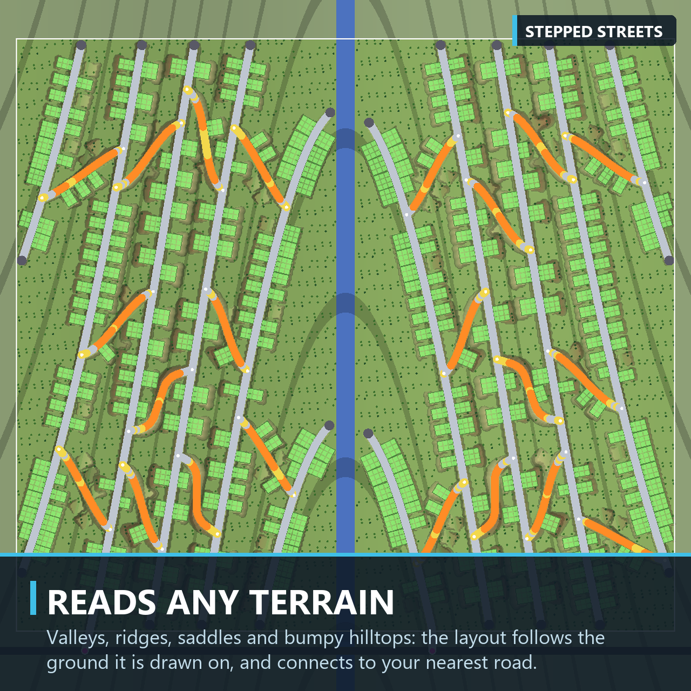
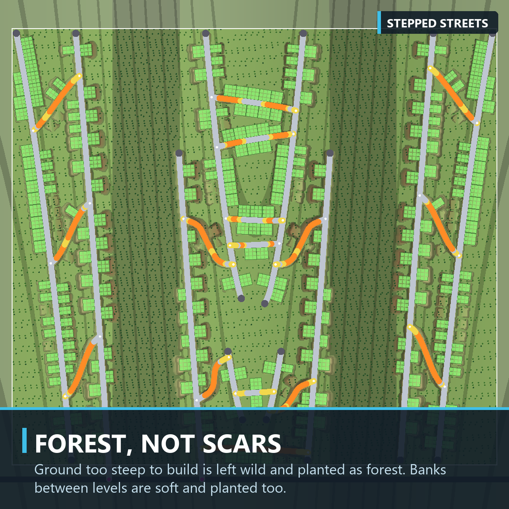
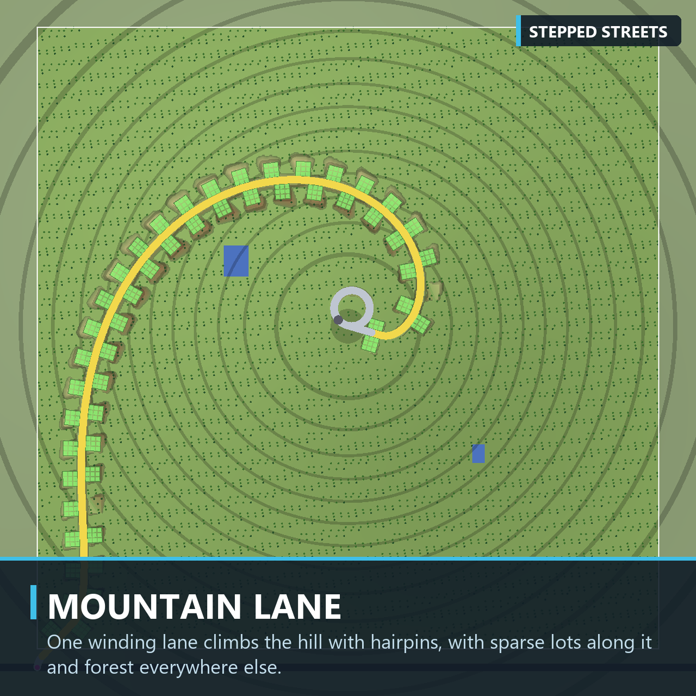

<div align="center">



<h1>Stepped Streets</h1>

<p><strong>Whole hillside neighbourhoods for Cities: Skylines II, planned and built in one go.</strong></p>

<p>
<a href="https://mods.paradoxplaza.com/mods/166090/Windows"></a>
<a href="https://mods.paradoxplaza.com/mods/166090/Windows"></a>

<a href="LICENSE"></a>
</p>

<p>


</p>

<p>
<a href="#features">Features</a> ·
<a href="#how-to-use">How to use</a> ·
<a href="#settings">Settings</a> ·
<a href="#how-it-works">How it works</a> ·
<a href="#building-from-source">Building from source</a> ·
<a href="#credits">Credits</a>
</p>

</div>

---

Building on hills in Cities: Skylines II is slow, fiddly work: roads that climb too steeply, lumpy lots, torn-looking ground.
**Stepped Streets does it for you.** Draw an area on a hillside and it lays out the whole neighbourhood the way a careful
builder would, previews it on the ground, and builds it when you say so.

<p align="center">

</p>

## Features

- **Streets that follow the contours**, so they stay nearly level along the hill.
- **Gentle connectors** that climb across the slope, never steeper than the grade you set (8 % by default).
- **A connection to your road network** within 400 m, or a neighbourhood of its own when there is none.
- **Level lots stepped down the hill**, graded with soft banks before anything is zoned.
- **Zoning that grows**: the game's own zone cells along the new roads, full depth, in the mix of zones you choose.
- **Service buildings in the mix**: police, fire, health, schools, parks, utilities, any unlocked roadside service building,
  each on a level site of its own, facing the road.
- **Forest** on ground too steep to build, trees on the banks, and optional garden walls.
- **Three styles**, a live preview, and **Reroll** for another layout from the same area.
- **Steep hills mode** for slopes up to 60 %, and areas up to 6.4 km across.

<table>
<tr>
<td></td>
<td></td>
<td></td>
</tr>
<tr>
<td></td>
<td></td>
<td></td>
</tr>
</table>

## Installation

Subscribe on **[Paradox Mods](https://mods.paradoxplaza.com/mods/166090/Windows)**, either on the website or in the game's
mod browser, and restart the game.

## How to use

1. Open the tool: click **Stepped Streets** in the bottom toolbar beside Zones, or press <kbd>Ctrl</kbd>+<kbd>Shift</kbd>+<kbd>S</kbd>.
2. **Draw the area.** Click corners on the ground and click the first corner again to close it.
3. **Choose what to build.** Pick a style, then add zones with their shares and services with how many of each.
4. **Check the preview.** The plan appears on the ground within moments and updates with every change. Press **Reroll** for
   another layout.
5. **Build.** The ground is graded, the roads are laid, the lots are zoned, and the services and trees are placed.

| Control | Action |
|---|---|
| Left-click | Place a corner; click the first corner to close the area |
| Drag a corner | Reshape the area |
| Drag an edge | Add a corner there |
| Right-click | Remove the corner under the cursor |
| <kbd>Enter</kbd> | Close the area |
| <kbd>Ctrl</kbd>+<kbd>Z</kbd> | Undo |
| <kbd>Esc</kbd> | Clear the area; press again to close the tool |

> [!IMPORTANT]
> Ground changes are permanent, like the game's own terrain tools. **Back up your save before a big build.**

The area does not have to touch a road. Groups of streets that can't reach your road network are still built, and the panel
tells you so you can join them up with a road of your own.

### Reading the preview

| Colour | Meaning |
|---|---|
| Grey road | Under 3 % grade |
| Yellow road | Under 6 % |
| Orange road | Up to the maximum grade |
| Zone colours | Lots, coloured by zone |
| Blue pad | A service building's site; the white edge faces the road |
| Brown and tan | Ground being cut and filled |

## Styles

| Style | What you get |
|---|---|
| **Contour suburb** (default) | Streets on the contours, linked by diagonal ramps and S-curves, every lot on its own level pad. |
| **Terraced blocks** | Straighter, level streets so each side of a block is one terrace, with plain connectors between them. |
| **Mountain lane** | One winding road that climbs with hairpins, sparse lots along it, forest everywhere else. |

## Settings

The panel shows the essentials; everything else is under **More settings**. One zone cell is 8 m.

| Setting | Range | Default | What it does |
|---|---|---|---|
| Style | see above | Contour suburb | The kind of layout. |
| Zones | zones and shares | Residential Low | Each lot's zone. **Add a zone** mixes in another. |
| Services | buildings and counts (1–20) | none | Service buildings on level sites beside the new roads. **Add a service** adds one. |
| Mix mode | Random, Clumps, Even | Clumps | How a zone mix is spread: per lot, in runs of neighbouring lots, or evenly. |
| Steep hills | on / off | off | Build on slopes up to 60 % with up to 12 m of earthwork; connectors may switch back. |
| Trees | on / off | on | Forest on steep ground, trees on banks and in the gaps between lots. |

<details>
<summary><strong>More settings</strong></summary>

<br>

| Setting | Range | Default | What it does |
|---|---|---|---|
| Road type | the game's zoning roads | Small Road | The road used for every new street. |
| Block depth | 60–200 m | 90 m | The distance between neighbouring contour streets. |
| Max road grade | 4–12 % | 8 % | No new road is steeper. |
| Steepest buildable | 8–30 % (60 % with Steep hills) | 15 % | Steeper ground gets no roads or lots and becomes forest. |
| Lot width, lot depth | 2–6 cells | 3 × 3 | The size of each lot. |
| Space between lots | Auto, 0, 1, 2 cells | Auto | Auto leaves planted gaps on steeper ground. |
| Level the lots | on / off | on | Grade each lot into a level pad. Off grades only the roads. |
| Most earth | 1–8 m (12 m with Steep hills) | 4 m | A lot that needs more cut or fill is left out. |
| Steepest bank | 20–50 % | 40 % | No slope the grading makes is steeper. |
| Retaining walls | on / off | off | Garden walls where a road runs through a cutting. |
| Tree density | 10–100 % | 50 % | How many trees to plant. |
| Seed | 1–99999 | 1 | Which layout. The same seed and settings always give the same plan. |

</details>

## How it works


The generator follows the rules experienced players use on hills. It surveys the ground on a 4 m grid and smooths it, so small
lumps don't bend the streets. It traces contour lines a constant height apart, so neighbouring streets sit about one block
depth apart, and keeps the ones on buildable land, smoothed into gentle curves. Connectors leave and meet the streets nearly
square and climb across the slope within the maximum grade. Every road is then checked again for grade, curve radius,
junction angle, spacing and clearance, and anything that fails is dropped rather than built badly.

The ground is shaped as one field: roads and lots are held level, and everything around them eases back to the hillside no
steeper than the steepest bank. Where two levels would need a steeper bank, the lot gives way. Planning runs off the main
thread, so the game keeps running while a big area is planned.

## Known limitations

- Ground changes can't be undone by the mod.
- Areas are limited to 6.4 km on a side. A whole hillside that size can take most of a minute to plan and lays hundreds of
  kilometres of road at once.
- On true mountain slopes (40–50 %), even with Steep hills on, the plan keeps the gentler streets and the lots that fit;
  streets no connector can reach within the grade are left out rather than built as roads to nowhere.
- Every group of streets is joined to your roads. A group that no gentle road can join is left out, and the panel tells
  you so.
- Houses grow only where the city has demand for that zone; the panel tells you when a chosen zone has none yet.
- English only.

Found a problem? [Open an issue](https://github.com/TevBenji/Stepped-Streets/issues) with a screenshot and the log at
`%USERPROFILE%\AppData\LocalLow\Colossal Order\Cities Skylines II\Logs\SteppedStreets.log`.

## Building from source

**Requirements:** Windows, Cities: Skylines II, the .NET SDK 9 or later, and Node.js 18 or later. The mod targets
.NET Framework 4.8 with C# 9 and compiles against the game's own assemblies.

```powershell
git clone https://github.com/TevBenji/Stepped-Streets.git
cd Stepped-Streets/src/SteppedStreets.UI
npm ci
cd ../..
dotnet build SteppedStreets.sln -c Release
```

The build writes the mod, including the panel bundle, to `src/SteppedStreets/bin/Release`. If the game is not installed under
`D:\Steam`, point the build at it:
`-p:ManagedPath="<Steam library>\steamapps\common\Cities Skylines II\Cities2_Data\Managed"`.

To install a build by hand, close the game and copy everything in `src/SteppedStreets/bin/Release`, keeping the `images`
folder, into `%USERPROFILE%\AppData\LocalLow\Colossal Order\Cities Skylines II\Mods\SteppedStreets`.

### Project layout

| Folder | What's in it |
|---|---|
| `src/SteppedStreets.Core` | The planner: pure C#, no game types, so it runs and is tested outside the game |
| `src/SteppedStreets` | The mod: the tool, the preview, the build steps and the settings |
| `src/SteppedStreets.UI` | The panel: React and TypeScript, bundled for the game's UI |
| `tools` | The Paradox Mods publishing script |

## Credits

Stepped Streets is made by [TevBenji](https://github.com/TevBenji). Parts of the build code are adapted from
**[Placemaker](https://github.com/jackwrichards/placemaker)** by jackwrichards, which in turn credits ParkManager by tomkpunkt,
Grid Road Generator by Ti4goc, ParkingLotTool by KruemelGames and CS2-NetworkTools by Luca Rager. The full, file-by-file
account is in [CREDITS.md](CREDITS.md).

## Licence

Released under the [GNU General Public License v3.0](LICENSE). Cities: Skylines II is a trademark of Paradox Interactive;
this is an independent mod, not made or endorsed by Paradox Interactive or Colossal Order.
